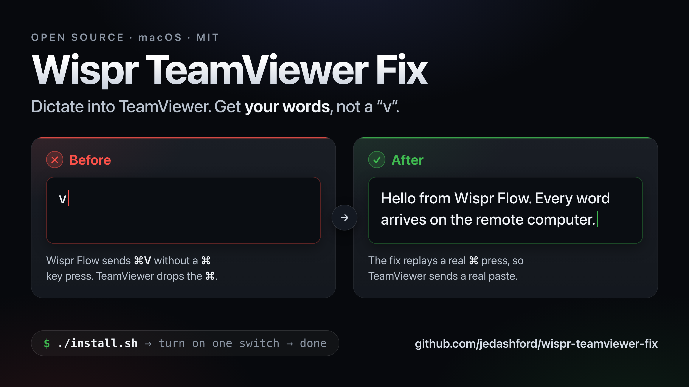
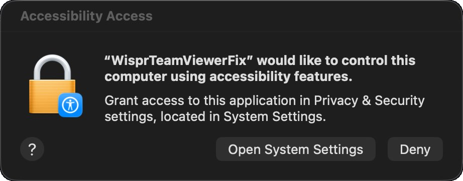
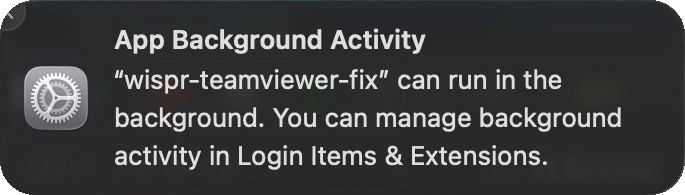

# Wispr TeamViewer Fix

A macOS helper that fixes Wispr Flow when it types only "v" in a TeamViewer window.

[](https://github.com/jedashford/wispr-teamviewer-fix/actions/workflows/ci.yml)
[](https://github.com/jedashford/wispr-teamviewer-fix/releases)
[](LICENSE)


[](CONTRIBUTING.md)



> This project is independent. It is not affiliated with Wispr or TeamViewer.

**Contents**

- **Start:** [At a glance](#at-a-glance) · [See it run](#see-it-run) · [The problem](#the-problem) · [Why it happens](#why-it-happens)
- **Use:** [Install](#install) · [Test it](#test-it) · [Check your setup](#check-your-setup) · [Remote computer runs Windows](#remote-computer-runs-windows) · [Experimental: missed pastes in Chrome](#experimental-missed-pastes-in-chrome) · [Update](#update) · [Uninstall](#uninstall)
- **Reference:** [Terminal options](#terminal-options) · [Log file](#log-file) · [Problems and solutions](#problems-and-solutions) · [How it works](#how-it-works)
- **Project:** [Support](#support) · [Contributing](#contributing) · [License](#license)

## At a glance

|                     |                                                                                                                                                                                                            |
| ------------------- | ---------------------------------------------------------------------------------------------------------------------------------------------------------------------------------------------------------- |
| **What it does**    | It makes Wispr Flow paste the full text into a TeamViewer window. Without the helper, the remote computer gets only the letter "v".                                                                        |
| **When it runs**    | It starts when you log in. Then it runs in the background all the time. It does not wait for TeamViewer to start.                                                                                          |
| **What it changes** | It ignores every key except V. It changes an event only when TeamViewer is the front app. With the opt-in `--chrome` mode, it also delays a synthetic Cmd+V in Chrome. In all other apps, it does nothing. |
| **Idle cost**       | No measurable CPU. Memory: about 3 MB.                                                                                                                                                                     |
| **Paste apps**      | Wispr Flow: tested. TextExpander, Keyboard Maestro, Text Blaze and other apps that paste with a synthetic Cmd+V: not tested yet.                                                                           |
| **Permissions**     | Accessibility only. No network access. It never reads the clipboard.                                                                                                                                       |
| **Health check**    | `./doctor.sh` checks the install and prints a report. It only reads.                                                                                                                                       |
| **Version**         | 1.0.0                                                                                                                                                                                                      |

### Supported versions

| Status         | Setup                                                                                                                                    |
| -------------- | ---------------------------------------------------------------------------------------------------------------------------------------- |
| Tested         | macOS 26.6 Tahoe on Apple Silicon, TeamViewer 15.69.4, Wispr Flow 1.6.1144, remote computer on macOS                                     |
| Builds in CI   | macOS 14 and macOS 15 runners. Universal binary (arm64 and x86_64). Deployment target macOS 13. Build and self-check only.               |
| Not tested yet | Intel Macs (at runtime), older macOS versions (at runtime), remote computer on Windows (the `--windows` option exists), other paste apps |

If you use a setup that is not tested yet, send your results with the [compatibility report form](https://github.com/jedashford/wispr-teamviewer-fix/issues/new?template=compatibility_report.yml).

## See it run



The animation shows the real output of `./install.sh`.

## The problem

You use Wispr Flow on your Mac. You control a remote computer with TeamViewer. You dictate into a text box on the remote computer. The remote computer gets only the letter "v". TeamViewer settings do not change this.

Other vendors document the same problem:

- TextExpander: [TextExpander only expands the letter "v"](https://textexpander.com/learn/troubleshooting/general/textexpander-only-expands-the-letter-v)
- Wispr Flow: [Use Flow with remote desktops](https://docs.wisprflow.ai/articles/7336156466-use-flow-with-remote-desktops-citrix-rdp-vdi) (a manual workaround)
- Text Blaze: [Clipboard variable only returns "v" in Windows Remote Desktop](https://community.blaze.today/t/clipboard-variable-only-returns-v-in-windows-remote-desktop-mac-windows-rdp/55537)

## Why it happens

An event log on a real Mac shows this sequence:

1. Wispr Flow puts the text on the clipboard.
2. Wispr Flow sends one synthetic V key-down event with the Command flag set.
3. Wispr Flow does not send a separate Command key press.
4. TeamViewer sends a modifier key to the remote computer only if it sees a separate press of that key.
5. As a result, TeamViewer sends a plain "v".

## Install

### Requirements

- A Mac with TeamViewer.
- Apple Command Line Tools. The installer uses `swiftc` from these tools.

If Swift is not on your Mac, the installer shows `✗ Swift is missing` and opens the Apple installer window. When that installation is complete, run `./install.sh` again.

### Steps

1. Open Terminal.
2. Clone the repository.
   ```bash
   git clone https://github.com/jedashford/wispr-teamviewer-fix.git
   ```
3. Go to the new folder.
   ```bash
   cd wispr-teamviewer-fix
   ```
4. Run the installer. If the remote computer runs Windows, refer to [Remote computer runs Windows](#remote-computer-runs-windows).
   ```bash
   ./install.sh
   ```
   On a first install, the output is similar to this:
   ```text
     ╦ ╦╦╔═╗╔═╗╦═╗  ╔╦╗╔═╗╔═╗╔╦╗╦  ╦╦╔═╗╦ ╦╔═╗╦═╗  ╔═╗╦═╗ ╦
     ║║║║╚═╗╠═╝╠╦╝   ║ ║╣ ╠═╣║║║╚╗╔╝║║╣ ║║║║╣ ╠╦╝  ╠╣ ║╔╩╦╝
     ╚╩╝╩╚═╝╩  ╩╚═   ╩ ╚═╝╩ ╩╩ ╩ ╚╝ ╩╚═╝╚╩╝╚═╝╩╚═  ╚  ╩╩ ╚═
     paste fix for Wispr Flow in TeamViewer · v1.0.0

     ✓ macOS 26.6.2 on arm64
     ✓ Swift 6.3.3
     ✓ Built helper (0.9s)
     ✓ Self-check passed
     ✓ Installed ~/Applications/WisprTeamViewerFix.app
     ✓ Login service started (remote pastes with Cmd+V)

     ! One step left: give WisprTeamViewerFix Accessibility access.
       1. In the window from macOS, click "Open System Settings".
       2. Turn on the switch next to WisprTeamViewerFix.
       The Accessibility page opens now.

     Log: ~/Library/Logs/wispr-teamviewer-fix.log
   ```
5. The installer opens **System Settings → Privacy & Security → Accessibility**. macOS can also show this window. If you see it, click **Open System Settings**.

   

6. Turn on the switch next to **WisprTeamViewerFix**.

   

7. Make sure that the helper runs. Do the steps in [Check your setup](#check-your-setup).

The helper detects the access in approximately 2 seconds. You do not have to restart it.

If the helper already has Accessibility access when the installer starts it, the output ends with these lines:

```text
  ✓ Running. It starts each time you log in.

  remote> Hello from Wispr Flow. Every word arrives.

  Log: ~/Library/Logs/wispr-teamviewer-fix.log
```

On a terminal, the `remote>` line first shows a lone "v" (the problem). Then the full sentence replaces it (the fix).

#### If WisprTeamViewerFix is not in the list

1. Open **System Settings → Privacy & Security → Accessibility**.
2. Click **+**.
3. Press Cmd+Shift+G.
4. Type `~/Applications/WisprTeamViewerFix.app`.
5. Press Return.
6. Click **Open**.
7. Turn on the switch next to **WisprTeamViewerFix**.

#### "App Background Activity" notice

macOS shows this notice after the install. It is about the login service of the helper. You do not have to do anything.



If you turn off **wispr-teamviewer-fix** under **System Settings → General → Login Items & Extensions** (**Allow in the Background**), the helper does not start when you log in.

### Installer options

| Option      | Effect                                                                                                                                                             |
| ----------- | ------------------------------------------------------------------------------------------------------------------------------------------------------------------ |
| (none)      | The remote computer is a Mac. The helper replays the paste with Command.                                                                                           |
| `--windows` | The remote computer runs Windows. Refer to [Remote computer runs Windows](#remote-computer-runs-windows).                                                          |
| `--chrome`  | Experimental. The helper waits 150 ms before a synthetic Cmd+V in Chrome. Refer to [Experimental: missed pastes in Chrome](#experimental-missed-pastes-in-chrome). |

You can use the two options together, in any order. Example: `./install.sh --windows --chrome`. Each run of the installer writes a new login service file. An option that you do not give is off.

### What the installer does

1. It builds `wispr-teamviewer-fix.swift` from source in a temporary folder.
2. It puts the helper in an app bundle and signs the app bundle ad hoc.
3. It runs a built-in self-check.
4. It stops the login service if it runs.
5. If the build changed, it puts the app bundle at `~/Applications/WisprTeamViewerFix.app` and removes the old Accessibility entry.
6. It writes a login service file at `~/Library/LaunchAgents/io.github.jedashford.wispr-teamviewer-fix.plist`.
7. It empties the log file and starts the login service.
8. It waits 2 seconds. If the helper does not have Accessibility access, it opens the Accessibility page in System Settings.

The login service starts the helper each time you log in. It also restarts the helper if the helper stops. A new build does not match the old Accessibility access. For this reason, the installer removes the old entry.

## Test it

1. Open a TeamViewer connection to the remote computer.
2. Click in a text box on the remote computer.
3. Dictate with Wispr Flow.
4. Make sure that the full text appears on the remote computer.

## Check your setup

`doctor.sh` checks the install and prints a report. It only reads. It changes nothing.

```bash
./doctor.sh
```

You can also run `make doctor`. On a healthy Mac, the output is similar to this:

```text
  ╦ ╦╦╔═╗╔═╗╦═╗  ╔╦╗╔═╗╔═╗╔╦╗╦  ╦╦╔═╗╦ ╦╔═╗╦═╗  ╔═╗╦═╗ ╦
  ║║║║╚═╗╠═╝╠╦╝   ║ ║╣ ╠═╣║║║╚╗╔╝║║╣ ║║║║╣ ╠╦╝  ╠╣ ║╔╩╦╝
  ╚╩╝╩╚═╝╩  ╩╚═   ╩ ╚═╝╩ ╩╩ ╩ ╚╝ ╩╚═╝╚╩╝╚═╝╩╚═  ╚  ╩╩ ╚═
  paste fix for Wispr Flow in TeamViewer · v1.0.0

  System
  ✓ macOS 26.6.2 on arm64
  ✓ TeamViewer 15.69.4
  ✓ Wispr Flow 1.6.1144
  Helper
  ✓ Installed: ~/Applications/WisprTeamViewerFix.app (1.0.0)
  ✓ Login service loaded, running (pid 1788)
  ✓ Accessibility access: on
  ✓ Remote paste key: cmd
  · Chrome paste delay: off
  Recent log
  · wispr-teamviewer-fix 1.0.0 running (remote pastes with cmd)
  · cmd+v in TeamViewer: source pid=95042 physicalCmd=false
  · replayed paste with cmd

  All checks passed. Paste this output into a bug report if you need help.
```

| Mark | Meaning                                                                                                                                                                        |
| ---- | ------------------------------------------------------------------------------------------------------------------------------------------------------------------------------ |
| `✓`  | The check passed.                                                                                                                                                              |
| `!`  | Warning. The doctor did not find an item, but the helper can work. This is not a failure.                                                                                      |
| `✗`  | The check failed. The line tells you what to do.                                                                                                                               |
| `·`  | Information, for example `· Chrome paste delay: off`. Under **Recent log**, a line from the log file. **Recent log** shows the last 5 lines, or `(empty)` if the log is empty. |

| Exit code | Meaning                                                                                |
| --------- | -------------------------------------------------------------------------------------- |
| `0`       | No check failed. Warnings can occur. The last line is `All checks passed...`.          |
| `1`       | One or more checks failed. The last line is `N problem(s) found. See the hints above.` |

If a check fails, do the step in the line:

| Line                                                                                                              | What to do                                                                         |
| ----------------------------------------------------------------------------------------------------------------- | ---------------------------------------------------------------------------------- |
| `✗ Not installed. Run ./install.sh`                                                                               | Run `./install.sh`. The doctor skips the other helper checks.                      |
| `✗ Login service not loaded. Run ./install.sh`                                                                    | Run `./install.sh`.                                                                |
| `✗ Login service loaded, but <state>. launchd retries every 10 s. See the log below.`                             | Read the lines under **Recent log**. If the problem continues, open an issue.      |
| `✗ Accessibility access: off. Turn on WisprTeamViewerFix in System Settings → Privacy & Security → Accessibility` | Turn on the switch. Refer to steps 5 and 6 of [Install](#steps).                   |
| `✗ Service file missing: ... Run ./install.sh`                                                                    | Run `./install.sh`.                                                                |
| `! TeamViewer not found in /Applications` (or Wispr Flow)                                                         | The doctor looks only in `/Applications`. The helper works from other folders too. |
| `! Accessibility access: unknown. The log has no start line.`                                                     | Run `./install.sh` again. It empties the log and starts the helper.                |

The [bug report form](https://github.com/jedashford/wispr-teamviewer-fix/issues/new?template=bug_report.yml) asks for this output. The output contains no typed text and no clipboard contents.

## Remote computer runs Windows

Windows pastes with Ctrl+V, not Cmd+V. If the remote computer runs Windows, install with this command:

```bash
./install.sh --windows
```

With `--windows`, the helper sends Control in the replay, not Command. The installer then shows `✓ Login service started (remote pastes with Ctrl+V)`. To change between a remote Mac and a remote Windows computer, run the installer again. Use `--windows` only for a remote Windows computer.

This option has no tests yet. Send your results with the [compatibility report form](https://github.com/jedashford/wispr-teamviewer-fix/issues/new?template=compatibility_report.yml).

## Experimental: missed pastes in Chrome

Chrome 155 and Chrome 156 on macOS sometimes ignore a paste from Wispr Flow. You dictate, but no text appears in Chrome. On the maintainer's Mac, approximately 11% of the dictations into Chrome did not appear after Chrome 155 became the stable version. Before that, no dictations were missing.

### Cause

Wispr Flow writes the text to the clipboard. Then it sends Cmd+V immediately.

1. Chromium change [8217390](https://chromium-review.googlesource.com/c/chromium/src/+/8217390) makes Chrome check the clipboard during a paste. If the clipboard changes during the paste, Chrome does not paste the new text.
2. On macOS, Chrome can find a clipboard change when no change occurred. This occurs most often when an app writes the clipboard and sends Cmd+V immediately after.
3. Chromium change [8503629](https://chromium-review.googlesource.com/c/chromium/src/+/8503629) repairs this problem. Chrome 157 is the first version with this repair.

Other dictation apps add a wait of approximately 150 ms before Cmd+V. Refer to [Hex issue 136](https://github.com/anomalyco/hex/issues/136) and [Hex pull request 137](https://github.com/anomalyco/hex/pull/137).

### Turn on the Chrome mode

1. Run the installer with `--chrome`. If the remote computer runs Windows, also add `--windows`.
   ```bash
   ./install.sh --chrome
   ```
2. Make sure that the installer shows `✓ Login service started (remote pastes with Cmd+V, Chrome paste delay 150 ms)`.
3. Run `./doctor.sh`. Make sure that it shows `✓ Chrome paste delay: 150 ms`.

With `--chrome`, the helper drops a synthetic Cmd+V in Chrome. It waits 150 ms. Then it sends the full key sequence: Command down, V down, V up, Command up. In Chrome, the helper always uses Command, also with `--windows`. If you press Cmd+V yourself, the helper does not change it. The Chrome mode does not change the behavior in TeamViewer.

This mode is experimental. The maintainer measures the rate of missed pastes in Chrome with and without it. The result is not known yet. Send your results with the [compatibility report form](https://github.com/jedashford/wispr-teamviewer-fix/issues/new?template=compatibility_report.yml).

### Turn off the Chrome mode

Run the installer without `--chrome`. If the remote computer runs Windows, add `--windows`.

```bash
./install.sh
```

`./doctor.sh` then shows `· Chrome paste delay: off`. Chrome 157 and later do not need the Chrome mode.

## Update

1. In Terminal, go to the `wispr-teamviewer-fix` folder.
2. Get the latest version.
   ```bash
   git pull
   ```
3. Run the installer again. If the remote computer runs Windows, add `--windows`. If you use the [Chrome mode](#experimental-missed-pastes-in-chrome), add `--chrome`.
   ```bash
   ./install.sh
   ```
4. If the installer does not show `✓ Same build as before, Accessibility stays on`, give Accessibility access again. Do steps 5 and 6 of [Install](#steps).
5. Run `./doctor.sh`. Make sure that the last line is `All checks passed...`.

## Uninstall

1. In Terminal, go to the `wispr-teamviewer-fix` folder.
2. Run the uninstaller.
   ```bash
   ./uninstall.sh
   ```
3. Delete the `wispr-teamviewer-fix` folder.

The uninstaller stops the helper. It deletes the app bundle, the login service file and the log file. It also removes the Accessibility entry. The last line is `Wispr TeamViewer Fix is removed. You can delete this folder now.`

## Terminal options

`install.sh`, `uninstall.sh` and `doctor.sh` use colors and animation on a terminal. These environment variables change the output. Any value that is not empty turns the option on.

| Variable        | Effect                                                     |
| --------------- | ---------------------------------------------------------- |
| `NO_COLOR=1`    | No colors and no animation.                                |
| `WTF_NO_ANIM=1` | No animation (spinner and closing animation). Colors stay. |
| `CI`            | No colors and no animation.                                |

If the output does not go to a terminal (for example, to a pipe or a file), the output is plain text. It has no colors and no animation. Example:

```bash
NO_COLOR=1 ./doctor.sh
```

## Log file

The helper writes to `~/Library/Logs/wispr-teamviewer-fix.log`. To see new lines when they arrive, run this command:

```bash
tail -f ~/Library/Logs/wispr-teamviewer-fix.log
```

Press Ctrl+C to stop the command. `./doctor.sh` also shows the last 5 lines.

Each line starts with the date and time, for example `2026-10-14 21:13:42.891`. The format is the same as in the macOS `log show` command. Thus you can compare a line with the TeamViewer log. Refer to [The paste is empty, shows old clipboard text, or does not appear](#the-paste-is-empty-shows-old-clipboard-text-or-does-not-appear).

| Line                                                          | Description                                                                                                                                                            |
| ------------------------------------------------------------- | ---------------------------------------------------------------------------------------------------------------------------------------------------------------------- |
| `wispr-teamviewer-fix 1.0.0 running (remote pastes with cmd)` | The helper started. With `--windows`, the line shows `ctrl`, not `cmd`. With `--chrome`, the line ends with `, Chrome paste delay 150 ms`.                             |
| `Waiting for Accessibility access...`                         | The helper does not have Accessibility access yet. Turn on the switch.                                                                                                 |
| `Accessibility access granted`                                | The helper has Accessibility access now.                                                                                                                               |
| `cmd+v in TeamViewer: source pid=95042 physicalCmd=false`     | The helper saw one Cmd+V in TeamViewer. `physicalCmd=false` means that you did not hold the Command key. If the value is `true`, the helper does not change the event. |
| `replayed paste with cmd`                                     | The helper sent the full key sequence to TeamViewer. With `--windows`, the line shows `ctrl`.                                                                          |
| `cmd+v in Chrome: source pid=95042 physicalCmd=false`         | Only with `--chrome`. The helper saw one Cmd+V in Chrome. `physicalCmd` has the same meaning as in TeamViewer.                                                         |
| `replayed paste in Chrome after 150 ms`                       | Only with `--chrome`. The helper waited 150 ms, then sent the full key sequence with Command to Chrome.                                                                |

The log contains only Cmd+V events in TeamViewer, and in Chrome with `--chrome`. It never contains other key presses or clipboard text.

## Problems and solutions

### Start with the doctor

1. Run the doctor.
   ```bash
   ./doctor.sh
   ```
2. If a line starts with `✗`, do the step in that line. Refer to [Check your setup](#check-your-setup).
3. Run `./doctor.sh` again. Continue when the last line is `All checks passed...`.

### The remote computer still gets only "v"

1. Run `./doctor.sh`. Make sure that it shows `✓ Accessibility access: on`.
2. Dictate a short text into TeamViewer.
3. Run `./doctor.sh` again. Look for `replayed paste` under **Recent log**.
4. If **Recent log** has no `cmd+v in TeamViewer` line, do the steps in [The switch is on, but the fix stopped after an update](#the-switch-is-on-but-the-fix-stopped-after-an-update).
5. If the problem continues, open an issue with the [bug report form](https://github.com/jedashford/wispr-teamviewer-fix/issues/new?template=bug_report.yml).

### The switch is on, but the fix stopped after an update

1. Open **System Settings → Privacy & Security → Accessibility**.
2. Select **WisprTeamViewerFix**.
3. Click **−**.
4. Run the installer again.
   ```bash
   ./install.sh
   ```
5. Give Accessibility access again. Do steps 5 and 6 of [Install](#steps).

### The paste is empty, shows old clipboard text, or does not appear

Wispr Flow puts your old clipboard back 0.5 seconds after an app reads the new text. TeamViewer must send the new text to the remote computer before that time. If TeamViewer is slow, the remote computer pastes old text or nothing. The helper log still shows `replayed paste`. This occurs most often on the first paste after you connect, and when the connection is slow.

1. In the TeamViewer options, make sure that clipboard synchronization is on.
2. To paste the text again, use the Wispr Flow shortcut **Paste last transcript**. Do not press Cmd+V. The clipboard has your old text again, so Cmd+V pastes the old text.
3. To find the cause, get the time of the paste from the [log file](#log-file). Then show the TeamViewer log for that time.

   ```bash
   /usr/bin/log show --last 15m --style compact --predicate 'subsystem == "com.teamviewer.TeamViewer"' | grep -E "StreamType_Clipboard|UnicodeKeyMap: instance|Lost Heartbeat"
   ```

   | Line in the TeamViewer log        | Meaning                                                                                                               |
   | --------------------------------- | --------------------------------------------------------------------------------------------------------------------- |
   | `StreamType_Clipboard`            | TeamViewer sent the clipboard to the remote computer. Look for one line less than 0.5 seconds after `replayed paste`. |
   | `UnicodeKeyMap: instance created` | TeamViewer prepared the keyboard for a new session. The first paste after you connect can fail.                       |
   | `Lost Heartbeat`                  | The connection was slow or broken.                                                                                    |

4. If the problem continues, increase `--wait`, for example to 800. Refer to [Delay flags](#delay-flags). Keep the value below 1000. With a longer wait, Wispr Flow can put the old clipboard back before the replay.

### Nothing appears on a remote Windows computer

1. Run `./doctor.sh`. Look at the `Remote paste key` line. It shows `ctrl` after `./install.sh --windows`.
2. If you installed with `--windows`, install again without it.
   ```bash
   ./install.sh
   ```
3. If you installed without `--windows`, install again with it.
   ```bash
   ./install.sh --windows
   ```
4. Report the results with the [compatibility report form](https://github.com/jedashford/wispr-teamviewer-fix/issues/new?template=compatibility_report.yml).

## How it works


The helper uses a keyboard event tap. It acts only when all of these conditions are true:

- TeamViewer is the front app. With `--chrome`, Chrome also counts. Refer to [Experimental: missed pastes in Chrome](#experimental-missed-pastes-in-chrome).
- A V key-down event has the Command flag.
- You do not hold the physical Command key.

Then the helper does these steps:

1. It drops the V key-down event and its key-up event.
2. It waits 150 ms. TeamViewer uses this time to sync the clipboard.
3. It sends a full key sequence, 30 ms apart: modifier down, V down, V up, modifier up.

TeamViewer sees a real modifier key press. As a result, it sends a real paste to the remote computer. The modifier is Command, or Control with `--windows`. If you press Cmd+V yourself, the helper does not change it.

The same sequence as a diagram (default `--key cmd`):

```text
Wispr Flow         wispr-teamviewer-fix                     TeamViewer        remote
    │                       │                                   │               │
    │ V↓ (⌘ flag, no ⌘ key) │                                   │               │
    │──────────────────────▶│ drop                              │               │
    │ V↑                    │                                   │               │
    │──────────────────────▶│ drop                              │               │
    │                       │ wait 150 ms                       │               │
    │                       │ ⌘↓ ─ V↓ ─ V↑ ─ ⌘↑  (30 ms apart)  │               │
    │                       │──────────────────────────────────▶│ real ⌘V       │
    │                       │                                   │──────────────▶│ "Hello…"
```

A Cmd+V that you type yourself (you hold the physical ⌘ key) passes through unchanged. With `--windows`, the replay uses Control (⌃), not Command.

### Delay flags

| Flag                | Default | Description                                                                                                                     |
| ------------------- | ------- | ------------------------------------------------------------------------------------------------------------------------------- |
| `--wait ms`         | 150     | Time before the replay. TeamViewer uses this time to sync the clipboard.                                                        |
| `--gap ms`          | 30      | Time between the events of the replay.                                                                                          |
| `--chrome-delay ms` | 0 (off) | Time before the replay in Chrome. The value 0 turns off the Chrome mode. The maximum is 2000. `./install.sh --chrome` sets 150. |

The installer sets only `--chrome-delay`, and only with `--chrome`. If pastes are empty or show old clipboard text on a slow connection, add `--wait`:

1. Open `~/Library/LaunchAgents/io.github.jedashford.wispr-teamviewer-fix.plist` in a text editor.
2. In the `ProgramArguments` array, add two items after the last item.
   ```xml
   <string>--wait</string>
   <string>300</string>
   ```
3. Stop the login service.
   ```bash
   launchctl bootout gui/$(id -u)/io.github.jedashford.wispr-teamviewer-fix
   ```
4. Start the login service again.
   ```bash
   launchctl bootstrap gui/$(id -u) ~/Library/LaunchAgents/io.github.jedashford.wispr-teamviewer-fix.plist
   ```

The installer writes a new login service file each time it runs. After you run `./install.sh`, add the flags again.

## Support

Run `./doctor.sh` first. Then use the form for your request:

| Form                                                                                                                    | Use it when                                                                                   |
| ----------------------------------------------------------------------------------------------------------------------- | --------------------------------------------------------------------------------------------- |
| [Bug report](https://github.com/jedashford/wispr-teamviewer-fix/issues/new?template=bug_report.yml)                     | The fix does not work. The form asks for the output of `./doctor.sh` and your versions.       |
| [Compatibility report](https://github.com/jedashford/wispr-teamviewer-fix/issues/new?template=compatibility_report.yml) | You tried a setup that is not tested yet. A "works" report also helps.                        |
| [Feature request](https://github.com/jedashford/wispr-teamviewer-fix/issues/new?template=feature_request.yml)           | You want a new feature or a change.                                                           |
| [Security advisory](https://github.com/jedashford/wispr-teamviewer-fix/security/advisories/new)                         | You found a security problem. Do not use a public issue. Refer to [SECURITY.md](SECURITY.md). |

To see the helper version, run this command:

```bash
~/Applications/WisprTeamViewerFix.app/Contents/MacOS/wispr-teamviewer-fix --version
```

## Contributing

The `Makefile` has shortcuts for contributors:

| Command               | What it does                                                                              |
| --------------------- | ----------------------------------------------------------------------------------------- |
| `make` or `make test` | Builds the helper, then runs `--selftest` and `--version`.                                |
| `make build`          | Builds the helper at `build/wispr-teamviewer-fix`.                                        |
| `make lint`           | Runs ShellCheck on `install.sh`, `uninstall.sh`, `doctor.sh` and `lib/ui.sh`.             |
| `make install`        | Runs `./install.sh`. For a remote Windows computer, run `./install.sh --windows` instead. |
| `make uninstall`      | Runs `./uninstall.sh`.                                                                    |
| `make doctor`         | Runs `./doctor.sh`.                                                                       |
| `make clean`          | Deletes the `build` folder.                                                               |

CI builds a universal binary and runs the self-check on macOS 14 and macOS 15. It also runs ShellCheck and a Prettier check of the docs. When you push a tag `vX.Y.Z`, the release workflow makes the GitHub release from the matching section of [CHANGELOG.md](CHANGELOG.md).

For the full guide, refer to [CONTRIBUTING.md](CONTRIBUTING.md). To report a security problem, refer to [SECURITY.md](SECURITY.md).

## License

MIT License. Copyright (c) 2026 Jed Ashford. Refer to [LICENSE](LICENSE).
