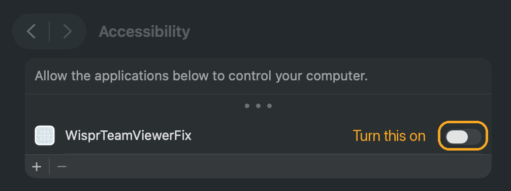
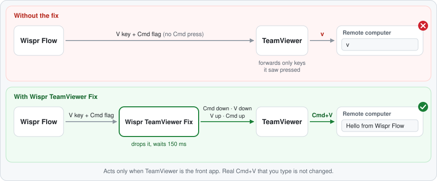

# Wispr TeamViewer Fix

A macOS helper that fixes Wispr Flow when it types only "v" in a TeamViewer window.

[](https://github.com/jedashford/wispr-teamviewer-fix/actions/workflows/ci.yml)
[](LICENSE)


> This project is independent. It is not affiliated with Wispr or TeamViewer.

## At a glance

|                     |                                                                                                                                     |
| ------------------- | ----------------------------------------------------------------------------------------------------------------------------------- |
| **What it does**    | It makes Wispr Flow paste the full text into a TeamViewer window. Without the helper, the remote computer gets only the letter "v". |
| **When it runs**    | It starts when you log in. Then it runs in the background all the time. It does not wait for TeamViewer to start.                   |
| **What it changes** | It ignores every key except V. It changes an event only when TeamViewer is the front app. In all other apps, it does nothing.       |
| **Idle cost**       | No measurable CPU. Memory: about 3 MB.                                                                                              |
| **Paste apps**      | Wispr Flow: tested. TextExpander, Keyboard Maestro, Text Blaze and other apps that paste with a synthetic Cmd+V: not tested yet.    |
| **Permissions**     | Accessibility only. No network access. It never reads the clipboard.                                                                |
| **Version**         | 1.0.0                                                                                                                               |

### Supported versions

| Status         | Setup                                                                                                          |
| -------------- | -------------------------------------------------------------------------------------------------------------- |
| Tested         | macOS 26.6 Tahoe on Apple Silicon, TeamViewer 15.69.4, Wispr Flow 1.6.1144, remote computer on macOS           |
| Builds in CI   | macOS 14 and macOS 15 (build and self-check only)                                                              |
| Not tested yet | Intel Macs, older macOS versions, remote computer on Windows (the `--windows` option exists), other paste apps |

If you use a setup that is not tested yet, please report your results in an [issue](https://github.com/jedashford/wispr-teamviewer-fix/issues).

## The problem

You use Wispr Flow on your Mac. You control a remote computer with TeamViewer. You dictate into a text box on the remote computer. The remote computer gets only the letter "v". TeamViewer settings do not change this.

Other vendors document the same problem:

- TextExpander: [TextExpander only expands the letter "v"](https://textexpander.com/learn/troubleshooting/general/textexpander-only-expands-the-letter-v)
- Wispr Flow: [Use Flow with remote desktops](https://docs.wisprflow.ai/articles/7336156466-use-flow-with-remote-desktops-citrix-rdp-vdi) (a manual workaround)
- Text Blaze: [Clipboard variable only returns "v" in Windows Remote Desktop](https://community.blaze.today/t/clipboard-variable-only-returns-v-in-windows-remote-desktop-mac-windows-rdp/55537)

## Why it happens

An event log on a real Mac shows this sequence:

1. Wispr Flow puts the text on the clipboard.
2. Wispr Flow sends one synthetic V key-down event with the Command flag set.
3. Wispr Flow does not send a separate Command key press.
4. TeamViewer sends a modifier key to the remote computer only if it sees a separate press of that key.
5. As a result, TeamViewer sends a plain "v".

## Install

### Requirements

- A Mac with TeamViewer.
- Apple Command Line Tools. The installer uses `swiftc` from these tools.

If Swift is not on your Mac, the installer opens the Apple installer window. When that installation is complete, run `./install.sh` again.

### Steps

1. Open Terminal.
2. Clone the repository.
   ```bash
   git clone https://github.com/jedashford/wispr-teamviewer-fix.git
   ```
3. Go to the new folder.
   ```bash
   cd wispr-teamviewer-fix
   ```
4. Run the installer. If the remote computer runs Windows, refer to [Remote computer runs Windows](#remote-computer-runs-windows).
   ```bash
   ./install.sh
   ```
   The output of the installer starts with these lines:
   ```text
   Building...
   selftest ok

   Installed. One step is left: give WisprTeamViewerFix Accessibility access.
   ```
5. The installer opens **System Settings → Privacy & Security → Accessibility**. macOS can also show a window that asks to let "WisprTeamViewerFix" control this computer. If you see that window, click **Open System Settings**.
6. Turn on the switch next to **WisprTeamViewerFix**.

   

The helper detects the access in approximately 2 seconds. You do not have to restart it.

#### If WisprTeamViewerFix is not in the list

1. Open **System Settings → Privacy & Security → Accessibility**.
2. Click **+**.
3. Press Cmd+Shift+G.
4. Type `~/Applications/WisprTeamViewerFix.app`.
5. Press Return.
6. Click **Open**.
7. Turn on the switch next to **WisprTeamViewerFix**.

#### "Background Items Added" notice

macOS can also show a "Background Items Added" notice. This notice is about the login service of the helper. If you turn off the helper under **System Settings → General → Login Items & Extensions** (**Allow in the Background**), the helper does not start when you log in.

### What the installer does

1. It builds `wispr-teamviewer-fix.swift` from source in a temporary folder.
2. It puts the helper in an app bundle and signs the app bundle ad hoc.
3. It runs a built-in self-check.
4. It stops the login service if it runs.
5. If the build changed, it puts the app bundle at `~/Applications/WisprTeamViewerFix.app` and removes the old Accessibility entry.
6. It writes a login service file at `~/Library/LaunchAgents/io.github.jedashford.wispr-teamviewer-fix.plist`.
7. It starts the login service.
8. If the helper does not have Accessibility access, it opens the Accessibility page in System Settings.

The login service starts the helper each time you log in. It also restarts the helper if the helper stops. A new build does not match the old Accessibility access. For this reason, the installer removes the old entry.

## Test it

1. Open a TeamViewer connection to the remote computer.
2. Click in a text box on the remote computer.
3. Dictate with Wispr Flow.
4. Make sure that the full text appears on the remote computer.

## Remote computer runs Windows

Windows pastes with Ctrl+V, not Cmd+V. If the remote computer runs Windows, install with this command:

```bash
./install.sh --windows
```

With `--windows`, the helper sends Control in the replay, not Command. To change between a remote Mac and a remote Windows computer, run the installer again. Use `--windows` only for a remote Windows computer.

This option has no tests yet. Please report your results in an [issue](https://github.com/jedashford/wispr-teamviewer-fix/issues).

## Update

1. In Terminal, go to the `wispr-teamviewer-fix` folder.
2. Get the latest version.
   ```bash
   git pull
   ```
3. Run the installer again. If the remote computer runs Windows, add `--windows`.
   ```bash
   ./install.sh
   ```
4. If the installer does not show `Same build as before`, give Accessibility access again. Do steps 5 and 6 of [Install](#steps).

## Uninstall

1. In Terminal, go to the `wispr-teamviewer-fix` folder.
2. Run the uninstaller.
   ```bash
   ./uninstall.sh
   ```
3. Delete the `wispr-teamviewer-fix` folder.

The uninstaller stops the helper. It deletes the app bundle, the login service file and the log file. It also removes the Accessibility entry.

## Log file

The helper writes to `~/Library/Logs/wispr-teamviewer-fix.log`. To see new lines when they arrive, run this command:

```bash
tail -f ~/Library/Logs/wispr-teamviewer-fix.log
```

Press Ctrl+C to stop the command.

| Line                                                          | Description                                                                                                                                                            |
| ------------------------------------------------------------- | ---------------------------------------------------------------------------------------------------------------------------------------------------------------------- |
| `wispr-teamviewer-fix 1.0.0 running (remote pastes with cmd)` | The helper started. With `--windows`, the line shows `ctrl`, not `cmd`.                                                                                                |
| `Waiting for Accessibility access...`                         | The helper does not have Accessibility access yet. Turn on the switch.                                                                                                 |
| `Accessibility access granted`                                | The helper has Accessibility access now.                                                                                                                               |
| `cmd+v in TeamViewer: source pid=95042 physicalCmd=false`     | The helper saw one Cmd+V in TeamViewer. `physicalCmd=false` means that you did not hold the Command key. If the value is `true`, the helper does not change the event. |
| `replayed paste with cmd`                                     | The helper sent the full key sequence to TeamViewer. With `--windows`, the line shows `ctrl`.                                                                          |

The log contains only Cmd+V events in TeamViewer. It never contains other key presses or clipboard text.

## Problems and solutions

### The remote computer still gets only "v"

1. Open **System Settings → Privacy & Security → Accessibility**.
2. Make sure that the switch next to **WisprTeamViewerFix** is on.
3. Dictate a short text into TeamViewer.
4. Look for a `replayed paste` line in the [log file](#log-file).
5. If the log has no `cmd+v in TeamViewer` line, make sure that the helper runs.
   ```bash
   launchctl print gui/$(id -u)/io.github.jedashford.wispr-teamviewer-fix
   ```
6. If the output does not show `state = running`, run the installer again.
   ```bash
   ./install.sh
   ```

### The switch is on, but the fix stopped after an update

1. Open **System Settings → Privacy & Security → Accessibility**.
2. Select **WisprTeamViewerFix**.
3. Click **−**.
4. Run the installer again.
   ```bash
   ./install.sh
   ```
5. Give Accessibility access again. Do steps 5 and 6 of [Install](#steps).

### The paste is empty or shows old clipboard text

1. In the TeamViewer options, turn on clipboard synchronization.
2. If the problem continues, increase `--wait`. Refer to [Delay flags](#delay-flags).

### Nothing appears on a remote Windows computer

1. If you installed with `--windows`, install again without it.
   ```bash
   ./install.sh
   ```
2. If you installed without `--windows`, install again with it.
   ```bash
   ./install.sh --windows
   ```
3. Report the results in an [issue](https://github.com/jedashford/wispr-teamviewer-fix/issues).

## How it works



The helper uses a keyboard event tap. It acts only when all of these conditions are true:

- TeamViewer is the front app.
- A V key-down event has the Command flag.
- You do not hold the physical Command key.

Then the helper does these steps:

1. It drops the V key-down event and its key-up event.
2. It waits 150 ms. TeamViewer uses this time to sync the clipboard.
3. It sends a full key sequence, 30 ms apart: modifier down, V down, V up, modifier up.

TeamViewer sees a real modifier key press. As a result, it sends a real paste to the remote computer. The modifier is Command, or Control with `--windows`. If you press Cmd+V yourself, the helper does not change it.

### Delay flags

| Flag        | Default | Description                                                              |
| ----------- | ------- | ------------------------------------------------------------------------ |
| `--wait ms` | 150     | Time before the replay. TeamViewer uses this time to sync the clipboard. |
| `--gap ms`  | 30      | Time between the events of the replay.                                   |

The installer does not set these flags. If pastes are empty or show old clipboard text on a slow connection, add `--wait`:

1. Open `~/Library/LaunchAgents/io.github.jedashford.wispr-teamviewer-fix.plist` in a text editor.
2. In the `ProgramArguments` array, add two items after the last item.
   ```xml
   <string>--wait</string>
   <string>300</string>
   ```
3. Stop the login service.
   ```bash
   launchctl bootout gui/$(id -u)/io.github.jedashford.wispr-teamviewer-fix
   ```
4. Start the login service again.
   ```bash
   launchctl bootstrap gui/$(id -u) ~/Library/LaunchAgents/io.github.jedashford.wispr-teamviewer-fix.plist
   ```

The installer writes a new login service file each time it runs. After you run `./install.sh`, add the flags again.

## Support

Open an issue with the [bug report form](https://github.com/jedashford/wispr-teamviewer-fix/issues/new/choose). The form asks for your versions and a log excerpt. To see the helper version, run this command:

```bash
~/Applications/WisprTeamViewerFix.app/Contents/MacOS/wispr-teamviewer-fix --version
```

## Contributing

Refer to [CONTRIBUTING.md](CONTRIBUTING.md). To report a security problem, refer to [SECURITY.md](SECURITY.md). For the changes in each version, refer to [CHANGELOG.md](CHANGELOG.md).

## License

MIT License. Copyright (c) 2026 Jed Ashford. Refer to [LICENSE](LICENSE).
